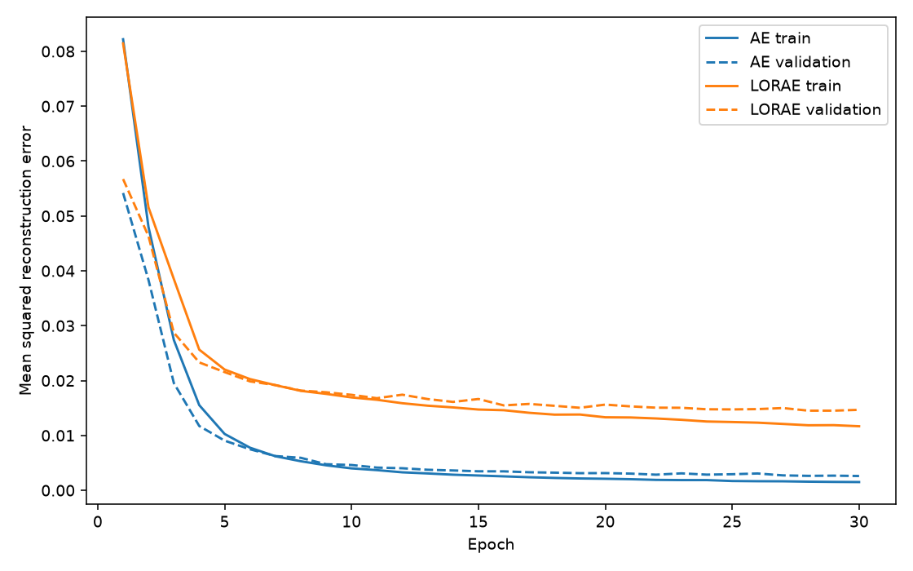
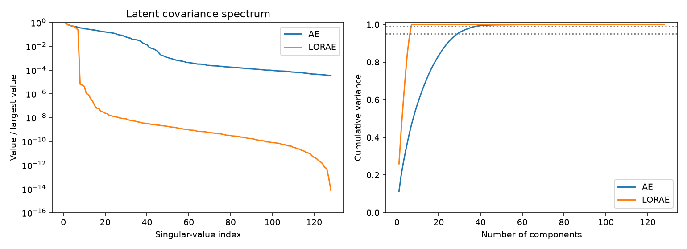
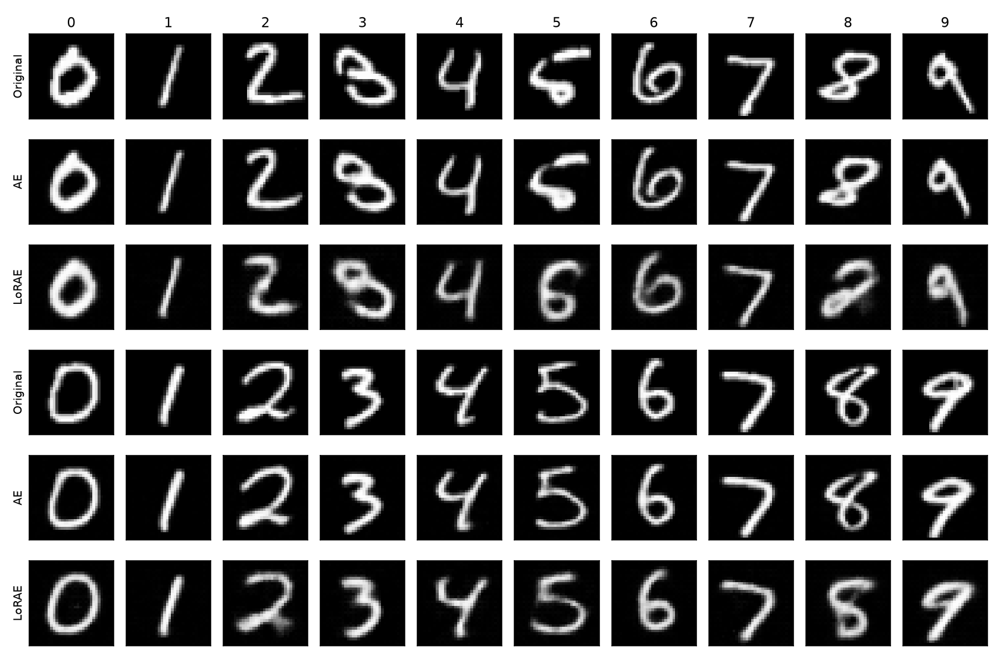
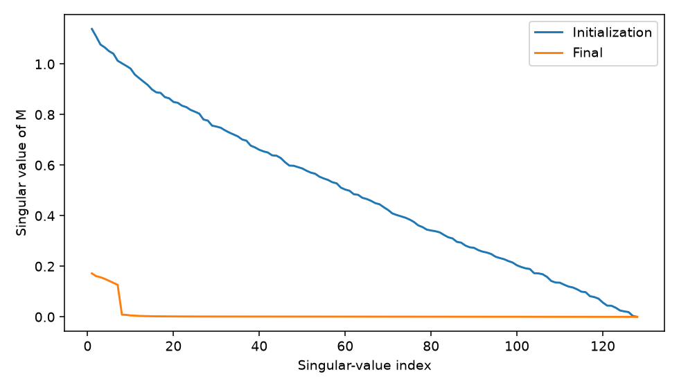

# LoRAE on MNIST

AI-generated educational implementation for CISC3024 AI Assignment #1. This project compares a standard convolutional autoencoder (AE) with a low-rank autoencoder (LoRAE) in a small, reproducible Windows CPU experiment. It is not the authors' official LoRAE repository and does not reproduce the paper's full benchmarks. No pretrained weights are used.

## Research, implementation and attribution

Original paper: Alokendu Mazumder, Tirthajit Baruah, Bhartendu Kumar, Rishab Sharma, Vishwajeet Pattanaik and Punit Rathore, **Learning Low-Rank Latent Spaces With Simple Deterministic Autoencoder: Theoretical and Empirical Insights**, IEEE/CVF WACV 2024 (arXiv preprint 2023).

- [Paper](https://arxiv.org/abs/2310.16194)
- [Official LoRAE implementation](https://github.com/tirthajit/LoRAE_WACV24)
- [IRMAE code lineage acknowledged by LoRAE](https://github.com/facebookresearch/irmae)

The AI-generated implementation was developed using the paper and official code. In particular, the MNIST model closely follows the upstream specification; this is not a fully independent implementation from the paper alone. See [ATTRIBUTION.md](ATTRIBUTION.md) for file-level provenance and inspected revisions.

**Licensing scope remains unresolved.** Upstream LoRAE carries Apache-2.0, while its acknowledged IRMAE lineage carries CC BY-NC 4.0. Both texts are preserved in [third_party_licenses](third_party_licenses/). Their inclusion does not settle which terms apply to each adapted portion. No blanket repository-wide license or unrestricted reuse permission is asserted.

## Preserved method and assignment adaptations

LoRAE uses `h = E(x)`, `z = M h`, `x_hat = D(z)`, with a trainable, bias-free 128 x 128 linear transformation M and no intervening activation. Training minimizes pixel-mean reconstruction MSE plus `0.001 * nuclear_norm(M)`. The nuclear norm is the sum of singular values, not a rank count. Inference retains M. The standard AE uses the same encoder/decoder and omits M and its penalty entirely.

The encoder has four Conv/ReLU stages, channels 1 -> 32 -> 64 -> 128 -> 256, kernel 4, stride 2, padding 1; flatten 1024 and project to 128. The decoder projects 128 -> 8192, reshapes to 128 x 8 x 8, then uses ReLU and transposed convolutions 128 -> 64 -> 32 -> 1, with final Tanh. The first two transposed convolutions use 4/2/1; the last uses 1/1/0. This follows the official MNIST model. The paper's written squared-error objective sums image pixels; this implementation follows the official code's mean-MSE convention instead.

Assignment adaptations include a smaller training split, an isolated validation split, seed 42, matched initial encoder/decoder weights, paired batch ordering, CPU execution, a fixed validation-based duration rule, and additional reproducibility/evaluation diagnostics. The code separates reconstruction and penalty logging and implements an explicit unregularized AE baseline.

## Frozen experiment

- Official MNIST: 5,000 training, 1,000 validation, all 10,000 official test images. NumPy `default_rng(42).permutation(60000)` supplies the first 5,000 and next 1,000 indices; 54,000 training images are unused.
- Resize grayscale images to 32 x 32, bilinear with antialiasing; `ToTensor()`, float32 in [0,1]; no augmentation or normalization. Raw decoder outputs determine loss; clipping is only for display.
- Latent dimension 128; Adam, learning rate 0.001, betas (0.9, 0.999), epsilon 1e-8, no weight decay or scheduler; batch size 32 including the final partial batch.
- CPU float32, four intra-operation threads, one inter-operation thread, zero DataLoader workers; deterministic PyTorch operations and seed 42.
- Train each model for 10 epochs. Compare mean validation MSE at epochs 5-7 with epochs 8-10. If either model improves by at least 1%, resume both to 30 total epochs with optimizer/RNG/loader state restored. No further extension. Test evaluation occurs only after duration is finalized, using final-epoch weights.

Configuration is fixed in `config.py`; there are no command-line hyperparameter overrides.

## Tested environment and installation (PowerShell)

Tested on Windows 11, Intel Core i5-1340P, approximately 32 GB RAM, CPU only; Python 3.11.0 (64-bit), torch 2.9.1+cpu, torchvision 0.24.1+cpu, NumPy 2.4.6 and Matplotlib 3.11.2. No NVIDIA GPU or CUDA is required. [installed-packages.txt](installed-packages.txt) records all installed versions; it is an experiment inventory, not the installation command. The minimal installation below pins direct dependencies; transitive dependencies may differ from the historical inventory.

Install 64-bit Python 3.11, open PowerShell in this repository folder, and verify that `python` resolves to that interpreter. If necessary, substitute your verified Python 3.11 executable; do not rely on a stale launcher registration.

```powershell
python --version
python -m venv .venv
.\.venv\Scripts\python.exe -m pip install --upgrade pip
.\.venv\Scripts\python.exe -m pip install torch==2.9.1 torchvision==0.24.1 --index-url https://download.pytorch.org/whl/cpu
.\.venv\Scripts\python.exe -m pip install -r requirements.txt
```

The requirements file installs NumPy and Matplotlib. PyTorch/torchvision use the separate CPU package source above; torchaudio is not needed. See [official PyTorch installation instructions](https://pytorch.org/get-started/previous-versions/#v291).

Optional activation: `.\.venv\Scripts\Activate.ps1`. Activation is unnecessary when using the explicit interpreter commands; no execution-policy changes are required.

MNIST is downloaded automatically into `data/` on first use, so an internet connection is initially required. No dataset is bundled.

## Run commands

Limited smoke test (two training batches per model, one validation batch, and synthetic plotting/continuation fixtures; no official test evaluation):

```powershell
.\.venv\Scripts\python.exe -B smoke_test.py
```

**The following command immediately begins full training and then evaluation:**

```powershell
.\.venv\Scripts\python.exe -B run.py
```

Each invocation creates a unique timestamp/UUID folder under `results/`; earlier runs and `published_results/` are not overwritten. There is no public resume CLI. Internal 10-to-30 continuation restores its own saved states. Load only trusted local checkpoints.

## Completed results

Both models extended to 30 epochs under the frozen rule. Results are for the full 10,000-image official test set.

| Metric | Standard AE | LoRAE |
|---|---:|---:|
| Test reconstruction MSE | 0.00255508045 | 0.01427050384 |
| Parameters | 2,041,057 | 2,057,441 |
| Training + validation time (s) | 241.87 | 221.43 |
| Components explaining 95% variance | 29 | 7 |
| Components explaining 99% variance | 38 | 7 |

Final M nuclear norm: 1.158299207687378; weighted penalty: 0.001158299207687378. Timing excludes checkpoint/CSV writing and final evaluation. Effective dimensions are covariance-variance summaries, not exact algebraic ranks. This run shows a reconstruction/representation-concentration trade-off; it establishes neither universal superiority nor an inherent speed advantage.

See [curated results](published_results/README.md) for original run identity, numerical files and provenance.






## Files and generated outputs

The seven Python modules implement configuration (`config.py`), models/loss (`models.py`), MNIST (`data.py`), training (`training.py`), evaluation (`evaluation.py`), orchestration (`run.py`) and checks (`smoke_test.py`). `PUBLIC_REPOSITORY_FILES.txt` is the intended publication manifest.

Local runs save configuration, exact split indices, environment/package metadata, source hashes, status, initial M, per-model histories/checkpoints, extension decision, metrics and raw numerical arrays. Evaluation generates reconstruction curves, LoRAE objective and nuclear-norm curves, covariance spectra, M singular values, matched reconstructions and fixed latent interpolations. LoRAE covariance uses M E(x); AE covariance uses E(x), with float64 sample covariance. Interpolations use fixed 0-to-1, 3-to-8 and 4-to-9 pairs with 11 points including endpoints.

Epoch logs use example-weighted batch averages; nuclear norm and penalty are recorded before each batch update. Final-checkpoint M norm in the verification record differs from the last epoch's batch-average norm. Smoke-only outputs are not experiment findings. `.venv/`, downloads, checkpoints and generated runs are excluded from publication; curated copies are included. Generated environment records contain local interpreter paths and should be reviewed before sharing.

## Limitations

One seed, one regularization coefficient, a small training subset and at most 30 epochs do not establish statistical significance or convergence. No classification, FID, GMM generation or full paper benchmark reproduction was performed. The comparison does not isolate every causal effect, and mean-MSE normalization matters when interpreting the regularization strength. Deterministic settings do not guarantee bit-identical outcomes across hardware/software versions. Runtime is machine-dependent.
